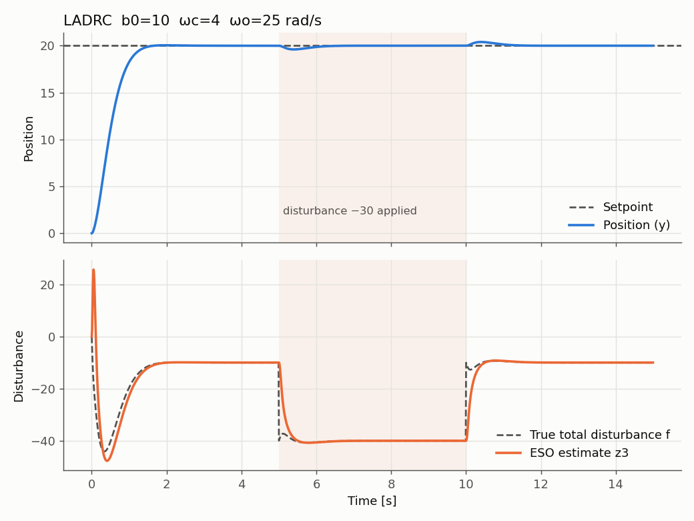

# ADRC — Active Disturbance Rejection Control per Arduino

[](https://github.com/gault3x3fa9/ADRC-Controller-Arduino-Library/actions/workflows/ci.yml)
[](LICENSE)

🇬🇧 [Read in English](README.md)

Un controllore **LADRC (Linear ADRC) di 2° ordine**, piccolo e senza dipendenze, con un'API ricalcata sulla classica libreria PID di Arduino (`Compute()`, `SetTunings()`, `SetOutputLimits()`, `SetMode()`).

Invece di tarare tre guadagni PID interdipendenti, scegli tre numeri con un significato fisico: il guadagno del sistema **b0**, la banda del controllore **ωc** e la banda dell'osservatore **ωo**. Un *Linear Extended State Observer* (LESO) stima posizione, velocità e un **disturbo totale** (attriti, carichi, dinamiche non modellate…), e il controllore cancella al volo questa stima.



*Gradino a 20, poi disturbo di −30 da t = 5 s a 10 s (uscita saturata a ±100). Riproducibile con `extras/python_simulation/adrc_simulation.py`.*

| Misurato nella simulazione qui sopra | Valore |
|---|---|
| Overshoot su un gradino di 20 | 0.05 (0.2 %) |
| Tempo di assestamento (2 %) | 1.3 s con ωc = 4 |
| Deviazione massima all'arrivo del disturbo −30 | 0.4 |
| Errore a regime | 0 |

Dati di un sistema simulato: su hardware reale i risultati cambiano (rumore del sensore, quantizzazione, ritardi dell'attuatore).

## Quando usare l'ADRC (e quando no)

L'ADRC tende a battere il PID quando il sistema ha inerzia (posizione/velocità di motori, gimbal, robot bilancianti) e quando carico o attrito cambiano durante il funzionamento: l'osservatore reagisce all'*effetto* del disturbo senza un modello di quest'ultimo. Servono una stima approssimativa di **b0**, una misura ragionevolmente pulita e veloce, e un sistema che si comporti più o meno come un 2° ordine. Per i processi lenti del 1° ordine (termici, controllo di velocità) usa la classe `ADRC1`: sulla pianta primo-ordine + tempo morto del benchmark batte sia il PID classico sia l'ADRC di 2° ordine (vedi *Risultati misurati*).

## ADRC o ADRC1 — quale usare?

`ADRC` assume una pianta del 2° ordine (`y'' = f + b0·u`): motori, servomeccanismi di posizione, robot bilancianti. `ADRC1` assume una pianta del 1° ordine (`y' = f + b0·u`): sistemi termici, velocità di ruota/ventola, carichi RC. Stessa API, stesse guardie e funzionalità (rampa, filtro, bumpless, saturazione); `GetZ2()` restituisce la stima del disturbo.

Stessa pianta del 1° ordine, stessi parametri di tuning (b0=K/τ, ωc=0.5, ωo=1.5):

| | assestamento | overshoot | incasso disturbo |
|---|---|---|---|
| `ADRC1` | **18.4 s** | **0.0 %** | **0.030** |
| `ADRC` (2°) | 32.3 s | 4.6 % | 0.043 |

Regola pratica: se l'attuatore accelera la grandezza che misuri, usa `ADRC`; se ne spinge direttamente la velocità di variazione, usa `ADRC1`.

## Installazione

- **Arduino IDE → Gestore librerie**: cerca "ADRC" *(una volta pubblicata)*.
- **Manuale**: scarica questa repo come ZIP, poi *Sketch → Includi libreria → Aggiungi libreria da file .ZIP…*

## Quick start

```cpp
#include <ADRC.h>

double Setpoint = 50.0;   // nelle TUE unità (qui: % del fondo scala)
double Input    = 0.0;
double Output   = 0.0;    // con segno: -255..255

double b0       = 200.0;  // guadagno del sistema (vedi "Guida alla taratura")
double omega_c  = 3.0;    // banda del controllore [rad/s]
double omega_o  = 15.0;   // banda dell'osservatore [rad/s]

ADRC myADRC(&Input, &Output, &Setpoint, b0, omega_c, omega_o);

void setup() {
  pinMode(3, OUTPUT);     // PWM
  pinMode(4, OUTPUT);     // direzione
  myADRC.SetOutputLimits(-255.0, 255.0);
  myADRC.SetSampleTime(10);          // 10 ms = 100 Hz
  myADRC.SetMode(AUTOMATIC);
}

void loop() {
  Input = analogRead(A0) * (100.0 / 1023.0);   // scala nelle tue unità

  if (myADRC.Compute()) {                      // true quando c'è un nuovo Output
    digitalWrite(4, Output >= 0 ? HIGH : LOW);
    analogWrite(3, (int)abs(Output));          // analogWrite non accetta negativi
  }
}
```

`Input`, `Setpoint` e `b0` devono usare unità coerenti, e l'uscita va adattata al tuo attuatore (un'uscita con segno richiede un pin di direzione o un driver bipolare). Un template completo è in `examples/BasicUsage`.

## Guida alla taratura

Il controllore assume che il sistema si comporti come `y'' = f + b0·u`, dove `f` è tutto ciò che non modelli.

1. **Trova b0** (unità: unità-di-input / s² per unità-di-output). Applica un piccolo gradino di uscita da fermo e misura l'accelerazione iniziale: `b0 ≈ accelerazione / uscita`. Una stima entro un fattore ~2 di solito basta; misurato sulla pianta della repo, l'anello converge con errore a regime nullo anche con b0 sbagliata di **4× in entrambe le direzioni** (a 8× degrada: lenta se sovrastimata, oscillante se sottostimata). Troppo *piccolo* → anello più aggressivo; troppo *grande* → più lento. Il segno definisce la direzione: **b0 negativo** quando un'uscita positiva fa diminuire l'ingresso (es. raffreddamento).
2. **Scegli ωc** [rad/s]: il tempo di assestamento è circa **5–6 / ωc** secondi. Parti basso (2–4) e aumenta finché la velocità è sufficiente senza saturare l'attuatore.
3. **Scegli ωo** [rad/s]: tipicamente **3–10 × ωc**. Più alto = stima del disturbo più veloce, ma più rumore del sensore in uscita. Abbassalo se l'uscita è rumorosa.
4. **Rispetta il limite di campionamento**: la stabilità dell'osservatore (Eulero esplicito) richiede **ωo · dt ≤ 0.5** (a 10 ms → ωo ≤ 50 rad/s). `myADRC.IsObserverSafe()` te lo dice; se serve un osservatore più veloce, riduci `SetSampleTime()`.

### Risoluzione dei problemi

| Sintomo | Causa probabile / rimedio |
|---|---|
| Uscita fissa al limite, risposta lenta e brutta | Gradino di setpoint troppo grande per l'attuatore: abbassa ωc, fai una rampa sul setpoint o alza i limiti. |
| Oscillazioni o vibrazioni | ωo troppo alto (rumore), ωc troppo alto o b0 troppo piccolo. |
| Molto lento | ωc troppo basso o b0 troppo grande. |
| Direzione sbagliata / scappa via | Segno di b0 (o della mappatura dell'attuatore) invertito. |
| `IsObserverSafe()` è false | ωo · dt > 0.5: abbassa ωo o il tempo di campionamento. (Tarature/periodi che violano il limite vengono rifiutati da `SetTunings`/`SetSampleTime`; il metodo resta come diagnostica.) |

## API

| Funzione | Descrizione |
|---|---|
| `ADRC(&Input, &Output, &Setpoint, b0, ωc, ωo)` | Costruttore. I parametri non validi vengono ignorati; si usano default sicuri. |
| `bool Compute()` | Da chiamare a ogni `loop()`. Calcola solo quando è trascorso il periodo di campionamento; restituisce `true` se `Output` è stato aggiornato. Le letture non finite (NaN/±Inf) vengono ignorate con uscita congelata; le chiamate rientranti sono no-op sicure. Se tarature assurde-ma-accettate fanno overfloware uno stato dell'osservatore, `Compute()` re-inizializza l'osservatore dalla misura corrente (auto-riparazione) e tiene l'uscita per quel giro. |
| `bool SetTunings(b0, ωc, ωo)` | Cambia la taratura al volo. Restituisce `false` senza modificare nulla per `b0 == 0`, valori subnormali o fuori range float, NaN/Inf, ω ≤ 0, ωo · dt > 0.5 al tempo di campionamento attuale, oppure guadagni derivati (Kp = ωc², Kd = 2ωc, βi) che sforerebbero il float. |
| `void SetSampleTime(ms)` | Periodo di campionamento (default 10 ms). 0, > 4000000, o valori che renderebbero ωo · dt > 0.5 vengono ignorati. |
| `void SetOutputLimits(min, max)` | Saturazione. Limiti non finiti o che non sopravvivono al narrowing in float (fuori range float, o min/max che collassano allo stesso valore) sono ignorati; restano attivi i limiti precedenti. L'osservatore usa l'uscita saturata, quindi non va in windup. Default 0..255: su sistemi bidirezionali imposta limiti simmetrici. |
| `bool SetSetpointRamp(rate)` | Limita la pendenza del riferimento interno, in (unità di input)/s: un cambiamento brusco del `Setpoint` diventa una rampa controllata (0 = disattivata, default). Restituisce `false` per rate negative o non finite. Con `SetMode(AUTOMATIC)` la rampa riparte dall'`Input` corrente (bumpless). `GetSetpointRamp()` la rilegge. |
| `bool SetInputFilter(hz)` | Filtro passa-basso a un polo sulla misura, prima dell'osservatore (cutoff in Hz, 0 = disattivo, default). Attenua il rumore del sensore così resta utilizzabile un ωo alto; guadagno DC esattamente 1. Un cutoff troppo basso aggiunge ritardo e limita il ωc raggiungibile. `GetInputFilter()` lo rilegge. |
| `void SetMode(AUTOMATIC / MANUAL)` | Passando ad `AUTOMATIC` l'osservatore viene inizializzato da Input/Output correnti: **bumpless transfer**. |
| `void Initialize()` | Reinizializza manualmente l'osservatore. |
| `bool IsObserverSafe()` | `true` se ωo · dt ≤ 0.5. |
| `GetZ1() / GetZ2() / GetZ3()` | Posizione stimata (filtrata), velocità e disturbo totale stimati. |
| `GetB0() / GetOmegaC() / GetOmegaO()` | Taratura corrente. |
| `bool SetNonlinearProfile(a1, a2, ao, dCtrl, dObs)` | *(solo NLADRC)* Profilo `fal` di Han, opt-in. Esponenti a 1 (default) = equivalenza lineare esatta; rifiutato per valori invalidi o coefficienti fal (1/δ^(1−α)) che sforerebbero il float. |

## Esempi

| Esempio | Cosa mostra |
|---|---|
| `SimulatedSystem` | Funziona su qualsiasi scheda **senza hardware**: sistema simulato, disturbo di −30 a 5 s, grafici live di posizione, uscita e disturbo stimato vs. reale (Serial Plotter, 115200 baud). |
| `BasicUsage` | Template per un motore DC (PWM + direzione) con sensore di posizione analogico. *Solo template: controllato sintatticamente, non provato su hardware reale — adatta pin, scala e taratura.* |
| `ADRC1Heater` | Template per il controllo di temperatura con la `ADRC1` del primo ordine: riscaldatore SSR/MOSFET + sensore analogico, filtro sull'ingresso e rampa del setpoint inclusi. *Solo template — adatta pin, scala e taratura.* |

## Risultati misurati

Tutte le evidenze sono generate dal codice reale della libreria tramite il sistema di test su PC in `extras/test/` — ogni numero qui sotto è riproducibile con i comandi in fondo alla pagina. Stack di verifica: 98 check funzionali, 25 riproduttori avversariali, un fuzz deterministico (1,2M iterazioni API casuali + 900k passi di chaos in closed loop, 0 violazioni di invariante — senza warning con `-std=gnu++11 -Wall -Wextra -Wpedantic` e pulito sotto UBSan), e il benchmark ADRC-vs-PID qui sotto. L'esempio `SimulatedSystem` è stato inoltre eseguito su hardware reale (scheda classe RP2040): risposta al gradino, reiezione del disturbo e tracking dell'osservatore combaciano con la simulazione entro la risoluzione di campionamento.

**Campagna casi d'uso** (`usage_campaign`, vedi `extras/test/README.md`): sei scenari tipici Arduino — posizione motore, velocità con b0 sbagliata ±2×, termica con ritardo 0.8 s, PWM 8 bit + ADC 10 bit + rumore, Peltier inversa (b0 < 0), tracking a onda quadra.

| Scenario | Risultato |
|---|---|
| Posizione motore, gradino 20, disturbo −30 | overshoot 0.23 %, assestamento 1.3 s, incasso disturbo 2 % del setpoint |
| Velocità ruota, guadagno ±2× (stessa taratura) | overshoot ≤ 1 %, errore a regime ≤ 0.002 |
| Termica, τ = 25 s, ritardo 0.8 s | assestamento 52 s, errore 0.01 °C, porta aperta → 0.085 °C |
| PWM 8 bit + ADC 10 bit + rumore | stesse dinamiche; ciclo limite ≈ 2 % del setpoint |
| Peltier, b0 < 0 | overshoot 1.7 %, errore nullo, rigetto carico immediato |
| Tracking onda quadra (6 inversioni) | peggiore overshoot 0.23 %, peggiore assestamento 1.3 s |

**Benchmark ADRC vs PID** (entrambi tarati dalla stessa grid-search automatica): su piante del 2° ordine tipo motore, stessa velocità nominale di un PID ottimizzato, **2–8× meno overshoot** quando la pianta cambia e **~50–120× meno jitter dell'attuatore** con rumore del sensore al 2 %. Sulla pianta 1° ordine + tempo morto l'ADRC di 2° ordine soffre (limitazione LADRC nota), ma **`ADRC1` batte il PID anche lì**: assestamento 1.48 s vs 1.73 s, overshoot 0.6 % vs 8.7 %, ess nullo, e con guadagno pianta raddoppiato 4.9 % vs 17.6 % di overshoot.

**CPU / ingombro, Arduino Uno R3 @ 16 MHz** (cross-validato simavr ↔ Wokwi cloud entro lo 0.06 %):

| | ADRC | PID classico |
|---|---|---|
| Update completo | 3507 cicli = 219 µs | 2008 cicli = 126 µs |
| Carico CPU @ 100 Hz / 1 kHz | 2.2 % / 22 % | 1.3 % / 13 % |
| Libreria + esempio | 6.7–7.1 KB flash (20–22 %), 340–430 B RAM | — |

## Limiti

- Modello di sistema del 2° ordine; niente termine integrale: l'errore a regime è eliminato dalla stima del disturbo.
- Se modifichi `Output` fuori dalla libreria (zona morta, rimappature), l'osservatore continua a supporre che il valore letto da `Output` sia stato applicato. Mantieni `Output` uguale a ciò che l'attuatore riceve davvero.
- I gradoni di setpoint saturano l'uscita; usa `SetSetpointRamp()` per trasformarli in una rampa controllata (un tracking differentiator completo non è ancora implementato).
- I sistemi con **ritardo dominante** (riscaldatori, tubi lunghi) calzano male all'`ADRC` di 2° ordine: richiede un ωo basso (limite sicuro misurato: **ωo ≤ ~0.75 / tempo-di-ritardo**) e resta un errore a regime. Usa lì la **`ADRC1`** — misurato sulla pianta con tempo morto del benchmark batte un PID tarato (1.48 s vs 1.73 s di assestamento, 0.6 % vs 8.7 % di overshoot, ess nullo).
- I calcoli interni usano `float`; sulle schede AVR a 8 bit `double` ha comunque la stessa dimensione.
- Il campionamento usa `micros()`; la prima chiamata dopo `SetMode(AUTOMATIC)` esegue subito il calcolo.

## Struttura della repository

```
src/                       ADRC.h, ADRC.cpp
examples/SimulatedSystem   demo senza hardware
examples/BasicUsage        template per hardware
extras/test                sistema di test su PC: unitari, robustezza,
                           benchmark ADRC vs PID, campagna casi d'uso, stub Arduino.h
extras/THEORY.md           derivazione matematica: LESO, stabilità discreta,
                           rumore, anti-windup, limiti
extras/python_simulation   specchio in Python + generatore del grafico
extras/bench_avr           benchmark CPU sul target (Uno / simavr / Wokwi)
keywords.txt, library.properties, LICENSE
```

Per eseguire i test in locale (qualsiasi compilatore C++; la CI usa `g++`):

```bash
g++ -Wall -Wextra -I extras/test/stub -I src extras/test/host_test.cpp      src/ADRC.cpp -o host_test      && ./host_test
g++ -Wall        -I extras/test/stub -I src extras/test/robustness_test.cpp src/ADRC.cpp -o robustness_test && ./robustness_test
g++ -O2 -Wall    -I extras/test/stub -I src extras/test/benchmark.cpp       src/ADRC.cpp -o benchmark      && ./benchmark
g++ -O2 -Wall -Wextra -I extras/test/stub -I src extras/test/usage_campaign.cpp src/ADRC.cpp -o usage_campaign && ./usage_campaign
```

Dettagli, log e report: [`extras/test/README.md`](extras/test/README.md).

## Sperimentale: NLADRC (variante non lineare con fal) — ramo feature

`NLADRC` implementa l'ADRC *non lineare* originale di Han: le correzioni lineari vengono sostituite (opt-in) dalla funzione `fal(e, α, δ)` tramite `SetNonlinearProfile()`. Con tutti gli esponenti a 1 (il default) la classe è **esattamente equivalente ad `ADRC`** — verificato alla quarta cifra decimale nella suite di test.

**Verdetto misurato sulle nostre piante** (stesso protocollo di tuning del benchmark): il profilo classico di Han (α₁=0.75, α₂=1.5, α₀=0.5) **non** batte l'ADRC lineare da nessuna parte dove abbiamo testato — step nominali (ITAE 10–40× peggio), grandi step saturi, tuning lenti — e amplifica il rumore del sensore ~8× sull'attuatore. Meccanismo: fuori dalla banda lineare `fal` *riduce* le correzioni dell'osservatore proprio quando le innovazioni sono grandi, e il suo guadagno alto vicino a zero amplifica il rumore. È la ragione storica per cui esiste il LADRC. La classe resta come opt-in sperimentale per casi d'uso esotici; per tutto ciò a cui questa libreria mira, usa `ADRC`/`ADRC1`.

## Riferimenti

Il LADRC e la sua parametrizzazione in banda derivano da Zhiqiang Gao, *"Scaling and bandwidth-parameterization based controller tuning"*, ACC 2003. La variante non lineare e `fal` derivano dai lavori originali di Jingqing Han (1998–2009).

Per la derivazione completa dietro le formule qui sopra — dinamica d'errore del LESO, limite esatto di stabilità dell'Eulero discreto (`ωo·dt < 2`) e perché la libreria impone 0,5, scalatura della sensibilità al rumore (`√ωo`), anti-windup strutturale, algebra del bumpless transfer e definizione di fal() — vedi **[extras/THEORY.md](extras/THEORY.md)**.

## Licenza

MIT — vedi [LICENSE](LICENSE).
