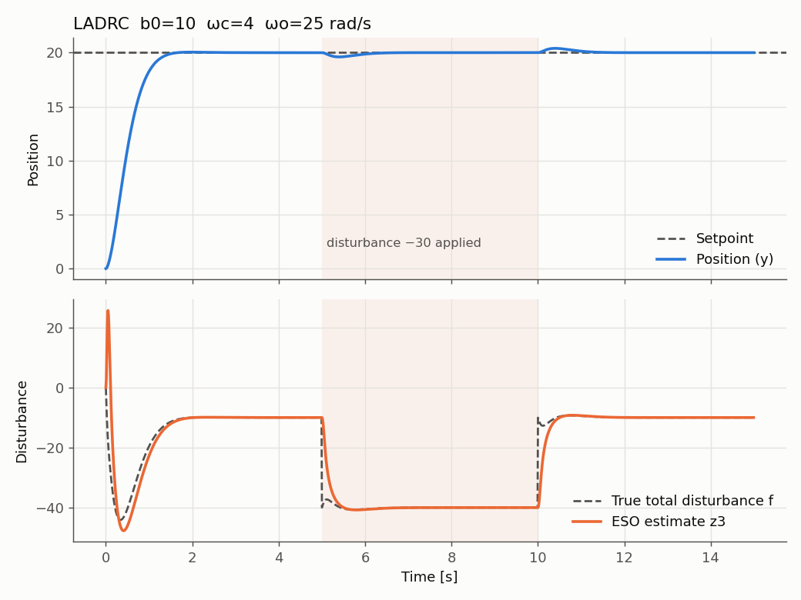

# ADRC — Active Disturbance Rejection Control for Arduino

[](https://github.com/gault3x3fa9/ADRC/actions/workflows/ci.yml)
[](LICENSE)

🇮🇹 [Leggimi in italiano](LEGGIMI.md)

A small, dependency-free **2nd-order Linear ADRC (LADRC)** controller with an API modelled on the classic Arduino PID library (`Compute()`, `SetTunings()`, `SetOutputLimits()`, `SetMode()`).

Instead of tuning three interdependent PID gains, you choose three numbers with a physical meaning: the plant gain **b0**, the controller bandwidth **ωc** and the observer bandwidth **ωo**. A *Linear Extended State Observer* (LESO) estimates position, velocity and a **total disturbance** (friction, load, unmodelled dynamics…), and the controller cancels that estimate on the fly.



*Step to 20, then a −30 disturbance from t = 5 s to 10 s (output saturated at ±100). Reproduce with `extras/python_simulation/adrc_simulation.py`.*

| Measured in the simulation above | Value |
|---|---|
| Overshoot on a step of 20 | 0.05 (0.2 %) |
| Settling time (2 %) | 1.3 s with ωc = 4 |
| Peak deviation when the −30 disturbance hits | 0.4 |
| Steady-state error | 0 |

Simulated plant; real hardware will differ (sensor noise, quantisation, actuator lag).

## When to use ADRC (and when not to)

ADRC tends to beat PID when the plant has inertia (motor position/speed, gimbals, balancing robots) and when load or friction change while running: the observer reacts to the *effect* of a disturbance without a model of it. You need a rough estimate of **b0**, a reasonably clean and fast measurement, and a plant that behaves roughly like a 2nd-order system. For slow, first-order processes a well-tuned PID can be just as good and simpler; on plants with dominant dead time a PID is usually the better choice (see *Limitations*).

## Installation

- **Arduino IDE → Library Manager**: search "ADRC" *(once published)*.
- **Manual**: download this repo as ZIP, then *Sketch → Include Library → Add .ZIP Library…*

## Quick start

```cpp
#include <ADRC.h>

double Setpoint = 50.0;   // in YOUR units (here: % of sensor range)
double Input    = 0.0;
double Output   = 0.0;    // signed: -255..255

double b0       = 200.0;  // plant gain (see "Tuning guide")
double omega_c  = 3.0;    // controller bandwidth [rad/s]
double omega_o  = 15.0;   // observer bandwidth  [rad/s]

ADRC myADRC(&Input, &Output, &Setpoint, b0, omega_c, omega_o);

void setup() {
  pinMode(3, OUTPUT);     // PWM
  pinMode(4, OUTPUT);     // direction
  myADRC.SetOutputLimits(-255.0, 255.0);
  myADRC.SetSampleTime(10);          // 10 ms = 100 Hz
  myADRC.SetMode(AUTOMATIC);
}

void loop() {
  Input = analogRead(A0) * (100.0 / 1023.0);   // scale to your units

  if (myADRC.Compute()) {                      // true when a new Output is ready
    digitalWrite(4, Output >= 0 ? HIGH : LOW);
    analogWrite(3, (int)abs(Output));          // analogWrite can't take negatives
  }
}
```

`Input`, `Setpoint` and `b0` must use consistent units, and the output must be mapped to your actuator (a signed output needs a direction pin or a bipolar driver). A complete template is in `examples/BasicUsage`.

## Tuning guide

The controller assumes the plant behaves like `y'' = f + b0·u`, where `f` is everything you don't model.

1. **Find b0** (units: input-units / s² per output-unit). Apply a small output step from rest and measure the initial acceleration: `b0 ≈ acceleration / output`. An estimate within a factor of ~2 is usually enough (in the repo's simulations both 0.5× and 2× converge with zero steady-state error). Too *small* → more aggressive loop; too *large* → sluggish. The sign sets the direction: **negative b0** when a positive output makes the input decrease (e.g. cooling).
2. **Choose ωc** [rad/s]: settling time ≈ **5–6 / ωc** seconds. Start low (2–4) and increase until fast enough without saturating the actuator.
3. **Choose ωo** [rad/s]: typically **3–10 × ωc**. Higher = faster disturbance estimation but more sensor noise in the output. Lower it if the output is noisy.
4. **Respect the sampling limit**: explicit-Euler observer stability needs **ωo · dt ≤ 0.5** (at 10 ms → ωo ≤ 50 rad/s). `myADRC.IsObserverSafe()` tells you; if you need a faster observer, shorten `SetSampleTime()`.

### Troubleshooting

| Symptom | Likely cause / fix |
|---|---|
| Output pinned at the limit, slow ugly response | Setpoint step too big for the actuator: lower ωc, ramp the setpoint, or raise the limits. |
| Oscillation or buzzing | ωo too high (noise), ωc too high, or b0 too small. |
| Very sluggish | ωc too low, or b0 too large. |
| Wrong direction / runs away | Sign of b0 (or of the actuator mapping) reversed. |
| `IsObserverSafe()` is false | ωo · dt > 0.5: lower ωo or the sample time. (Violating tunings/periods are rejected by `SetTunings`/`SetSampleTime`; the method remains as a diagnostic.) |

## API

| Function | Description |
|---|---|
| `ADRC(&Input, &Output, &Setpoint, b0, ωc, ωo)` | Constructor. Invalid parameters are ignored; safe defaults are used. |
| `bool Compute()` | Call every `loop()`. Runs only when a sample period elapsed; returns `true` if `Output` was updated. Non-finite (NaN/±Inf) readings are ignored with the output held; reentrant calls are safe no-ops. |
| `bool SetTunings(b0, ωc, ωo)` | Change tunings on the fly. Returns `false` and changes nothing for `b0 == 0`, subnormal or out-of-float-range values, NaN/Inf, ω ≤ 0, or ωo · dt > 0.5 at the current sample time. |
| `void SetSampleTime(ms)` | Sampling period (default 10 ms). 0, > 4000000, or values that would make ωo · dt > 0.5 are ignored. |
| `void SetOutputLimits(min, max)` | Saturation. Non-finite limits are ignored. The observer uses the saturated output, so it does not wind up. Default 0..255: on signed (bidirectional) plants set symmetric limits. |
| `bool SetSetpointRamp(rate)` | Slew-limit the internal reference, in (input units)/s: an abrupt `Setpoint` change becomes a controlled ramp (0 = disabled, default). Returns `false` for negative or non-finite rates. On `SetMode(AUTOMATIC)` the ramp restarts from the current `Input` (bumpless). `GetSetpointRamp()` reads it back. |
| `void SetMode(AUTOMATIC / MANUAL)` | Switching to `AUTOMATIC` initialises the observer from the current Input/Output: **bumpless transfer**. |
| `void Initialize()` | Re-initialise the observer manually. |
| `bool IsObserverSafe()` | `true` if ωo · dt ≤ 0.5. |
| `GetZ1() / GetZ2() / GetZ3()` | Estimated position (filtered), velocity, total disturbance. |
| `GetB0() / GetOmegaC() / GetOmegaO()` | Current tunings. |

## Examples

| Example | What it shows |
|---|---|
| `SimulatedSystem` | Runs on any board with **no hardware**: simulated plant, a −30 disturbance at 5 s, live plots of position, output and estimated vs. true disturbance (Serial Plotter, 115200 baud). |
| `BasicUsage` | Template for a DC motor (PWM + direction) with an analog position sensor. *Template only: syntax-checked, not run on real hardware — adapt pins, scaling and tuning.* |

## Measured results

All evidence is generated from the real library code by the host test system in `extras/test/` — every number below is reproducible with the commands at the bottom of this page. The `SimulatedSystem` example was also run on real hardware (RP2040-class board): step response, disturbance rejection and observer tracking all match the simulation within sampling resolution.

**Closed-loop usage campaign** (`usage_campaign`, see `extras/test/README.md`): six Arduino-typical scenarios — motor position, wheel speed with b0 off by ±2×, thermal plant with 0.8 s dead time, 8-bit PWM + 10-bit ADC + noise, reverse-acting Peltier (b0 < 0), square-wave tracking.

| Scenario | Result |
|---|---|
| Motor position, step 20, disturbance −30 | overshoot 0.23 %, settling 1.3 s, disturbance dip 2 % of setpoint |
| Wheel speed, plant gain ±2× (same tuning) | overshoot ≤ 1 %, steady-state error ≤ 0.002 |
| Thermal, τ = 25 s, dead time 0.8 s | settling 52 s, error 0.01 °C, door-open dip 0.085 °C |
| PWM 8 bit + ADC 10 bit + noise | same dynamics; limit cycle ≈ 2 % of setpoint |
| Peltier, b0 < 0 | overshoot 1.7 %, error 0, load rejection immediate |
| Square-wave tracking (6 reversals) | worst overshoot 0.23 %, worst settling 1.3 s |

**ADRC vs PID benchmark** (both tuned by the same automatic grid search): on 2nd-order motor-like plants, same nominal speed as an optimally tuned PID, **2–8× less overshoot** when the plant changes, and **~50–120× less actuator jitter** with 2 % sensor noise. On a first-order + dead-time plant the PID wins (known LADRC limitation).

**CPU / footprint, Arduino Uno R3 @ 16 MHz** (cross-validated simavr ↔ Wokwi cloud within 0.06 %):

| | ADRC | classic PID |
|---|---|---|
| Full update | 3507 cycles = 219 µs | 2008 cycles = 126 µs |
| CPU load @ 100 Hz / 1 kHz | 2.2 % / 22 % | 1.3 % / 13 % |
| Library + example | 6.7–7.1 KB flash (20–22 %), 340–430 B RAM | — |

## Limitations

- 2nd-order plant model; no integrator term: steady-state error is removed by the disturbance estimate.
- If you modify `Output` outside the library (deadband, remapping), the observer still assumes the value it read from `Output` was applied. Keep `Output` equal to what the actuator really receives.
- Large setpoint steps saturate the output; use `SetSetpointRamp()` to turn them into a controlled ramp (a full tracking differentiator is still not implemented).
- Plants with **dominant dead time** (heaters, long pipes) need a low ωo — measured safe bound: **ωo ≤ ~0.75 / dead-time**; above that the observer starts oscillating. A classic PID is usually the better tool there.
- Internal maths uses `float`; on 8-bit AVR boards `double` is the same size anyway.
- Scheduling uses `micros()`; the first call after `SetMode(AUTOMATIC)` runs immediately.

## Repository layout

```
src/                       ADRC.h, ADRC.cpp
examples/SimulatedSystem   no-hardware demo
examples/BasicUsage        hardware template
extras/test                host test system: unit, robustness, ADRC-vs-PID
                           benchmark, usage campaign, stub Arduino.h
extras/python_simulation   Python mirror + plot generator
extras/bench_avr           on-target CPU benchmark (Uno / simavr / Wokwi)
keywords.txt, library.properties, LICENSE
```

Run the tests locally (any C++ compiler; CI uses `g++`):

```bash
g++ -Wall -Wextra -I extras/test/stub -I src extras/test/host_test.cpp      src/ADRC.cpp -o host_test      && ./host_test
g++ -Wall        -I extras/test/stub -I src extras/test/robustness_test.cpp src/ADRC.cpp -o robustness_test && ./robustness_test
g++ -O2 -Wall    -I extras/test/stub -I src extras/test/benchmark.cpp       src/ADRC.cpp -o benchmark      && ./benchmark
g++ -O2 -Wall -Wextra -I extras/test/stub -I src extras/test/usage_campaign.cpp src/ADRC.cpp -o usage_campaign && ./usage_campaign
```

Details, logs and reports: [`extras/test/README.md`](extras/test/README.md).

## Background

LADRC and its bandwidth parameterisation come from Zhiqiang Gao, *"Scaling and bandwidth-parameterization based controller tuning"*, ACC 2003.

## License

MIT — see [LICENSE](LICENSE).
